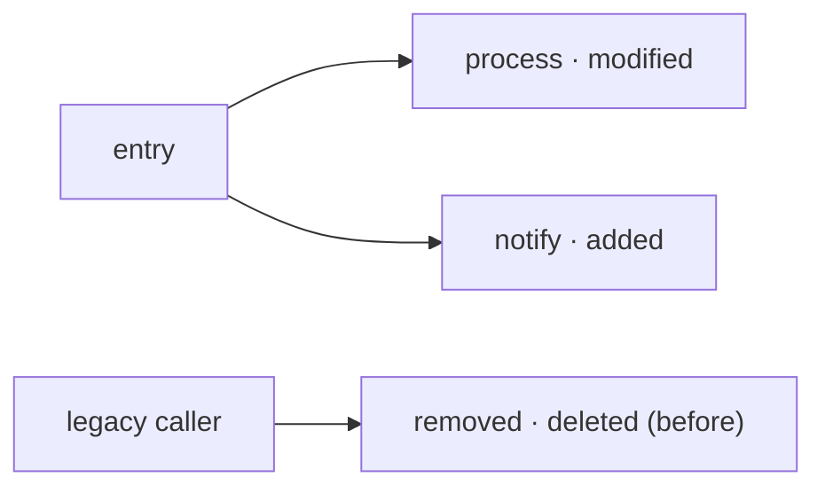
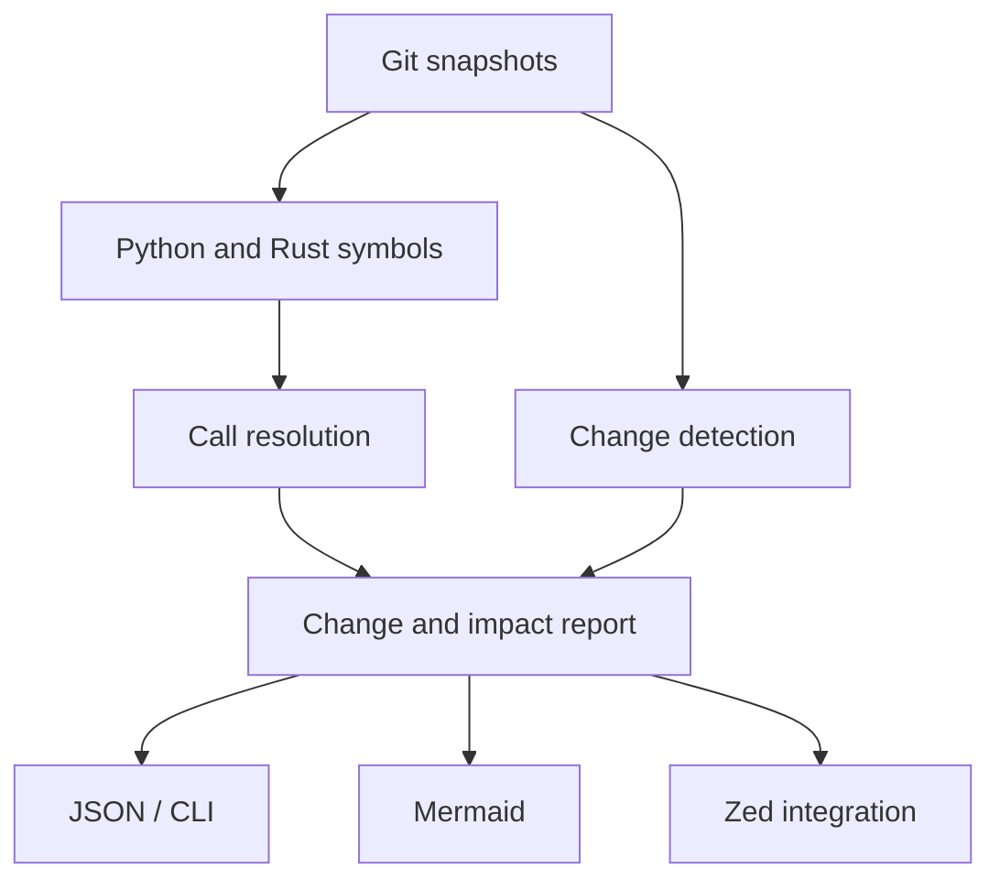

# DFlow

DFlow is an experimental Rust tool for exploring how changes in a Git repository affect Python and Rust function call graphs.

DFlow answers questions such as: *Which functions call the function I changed? What calls a newly added function? Who called a function before it was deleted?* It draws these relationships in the standalone CLI. A Zed integration is planned for later.

> **Status:** Python M4 technical validation is complete; its human comparative usability study remains open. Rust M5 adds captured-manifest/module discovery and conservative static analysis without building, running, or downloading dependencies of the analyzed project. DFlow compares Git snapshots, traces certain callers, draws an interactive terminal graph, and emits a [versioned JSON report](docs/report-schema-v1.md). Unresolved calls remain explicit.

## Intended workflow

1. Read two repository snapshots, such as a base commit and a target commit or working tree.
2. Parse captured Python and Rust source in both snapshots and identify functions, methods, imports, and call sites.
3. Match symbols across snapshots and classify them as added, modified, or deleted.
4. Resolve calls where possible and build a call graph for each snapshot.
5. Trace callers around changed symbols. Deleted symbols use the graph from the earlier snapshot.
6. Produce a structured report that presentation layers can render as JSON, Mermaid, or an editor view.

An intended diagram might look like this:



An arrow means **calls**: `entry → process` means `entry` calls `process`. To inspect the impact of a changed function, DFlow follows incoming arrows toward its callers.

## Architecture

The core will keep analysis separate from presentation:



The report carries symbol identity, source location, change type, call sites, and whether a call target was resolved. Dynamic Python calls and uncertain Rust dispatch remain explicitly unresolved rather than appearing as certain edges.

This is a conceptual boundary. The current implementation stays in one Rust crate with internal modules.

## Roadmap

- [x] Compare two Git snapshots and list changed Python and Rust files.
- [x] Extract Python functions and their source ranges.
- [x] Identify added, modified, and deleted symbols across snapshots.
- [x] Build a call graph for direct, statically resolvable calls.
- [x] Trace callers of changed symbols, including deleted symbols in the earlier snapshot.
- [x] Expose a stable JSON report through the CLI.
- [x] Draw an interactive terminal caller graph.
- [x] Analyze static Rust crate/module graphs and conservative intra-target calls.
- [ ] Render focused Mermaid diagrams from the report.
- [ ] Prototype a Zed workflow using the same core analysis.

Python support focuses on local calls and explicit imports. Method dispatch, dynamic imports, decorators, and runtime-generated calls require additional analysis and may remain unresolved.

Supported Python resolution covers direct lexical calls, explicit repository imports, aliases, known relative imports, and module-qualified calls where the binding is certain. Parameters, assignments, wildcard imports, uncertain package attributes, decorators, and dynamic dispatch remain unresolved rather than creating guessed edges. Rust resolves lexical free/nested functions, explicit `crate`/`self`/`super` module paths, static `use` aliases, and unique inherent associated functions within one crate target. Receiver/trait/UFCS dispatch, macro expansion, glob imports, re-exports, conditional compilation, unknown procedural attributes, external crates, and ambiguous bindings stay unresolved. JSON `unresolved_reason` is an open string field; [schema v1](docs/report-schema-v1.md) documents its meanings. Neither language is executed.

## Development

Install a Rust toolchain that supports the 2024 edition, then run:

For source formatting, follow the [Rust code style guidelines](docs/code-style.md) and run `cargo fmt --all` before committing.

```sh
cargo run -- local
cargo run -- local --staged
cargo run -- local --unstaged
cargo run -- branch --base main --target feature
cargo run -- local --format json --depth 2
cargo run -- --dir ../other-repo local
cargo run -- branch --base main --target feature --dir ../other-repo
```

`--dir DIR` selects the starting directory for Git repository discovery in either mode. Relative paths resolve against the process current directory, not the repository root; paths inside a repository work because discovery ascends to its root. Without `--dir`, discovery starts at the process current directory. A missing or non-repository directory is invalid input (exit 2).
If both stdin and stdout are terminals, the default output is an interactive graph. Otherwise the default is JSON. `--format json` always writes one JSON object to stdout; `--format tui` requires both terminals. Exit status is 0 for complete analysis, 1 for partial analysis or operational failure, and 2 for invalid input. A parse error produces a partial report, while an unresolved call by itself does not.

### Terminal controls

The terminal has two persistent areas: a DFlow information header showing both snapshot identities, caller depth, analysis completeness, counts, and shortcuts, above one full-width graph canvas. All changed symbols appear together, with unrelated caller graphs as separate islands and shared callers shown once. Each symbol box is titled `file_name:function_name` (module boxes use the module filename), always shows its basic location, and sizes to its content rather than truncating it. Press `d` to expand or collapse details inside the selected graph node, including snapshot-labeled source and call-site evidence where available; there is no separate Details panel. Expanded boxes can be wider than the viewport, so pan to see their full contents. Shared routes meet at junctions; panning clips the graph without breaking visible joins. Deleted roots and their callers use the **base** snapshot; added and modified roots use **target**. A partial analysis is visibly marked.

| Key | Action |
| --- | --- |
| Arrow keys or `j`/`k` | Select a graph node |
| `d` | Expand or collapse details in the selected graph node (collapsed by default) |
| Shift+arrow keys | Pan the graph, including wide nodes |
| Page Up / Page Down | Pan the graph vertically |
| `+` / `-` | Increase or decrease caller depth |
| `?` | Show or close help |
| `q` or Ctrl-C | Quit |

The terminal needs at least 60 columns and 12 rows. Narrower terminals show resize guidance. Renderer-owned box-drawing lines and arrows are single-cell Unicode glyphs. Added roots are green, deleted roots red, and modified roots yellow; roots with multiple change kinds have a distinct mixed style. Unchanged callers and connectors retain the terminal default color. Selection remains highlighted.

Run the current test suite with:

```sh
cargo test
```

The single root-level crate uses `git2` for Git snapshots. Tree-sitter parses Python and Rust source, including fixture-tested Rust 2018, 2021, and 2024 syntax editions (static syntax parsing, not edition-specific compiler/type checking). Python module discovery supports regular packages at the repository root or under `src/`, including a static setuptools `package-dir` root of `.` or `src` in `pyproject.toml`. Rust discovery uses captured root/workspace-member `Cargo.toml` manifests, conventional or explicit lib/bin roots, and unambiguous inline/external/`#[path]` modules; it does not expand Cargo globs, macros, build scripts, or dependencies. Missing/ambiguous Rust layouts and invalid source yield partial analysis. Local capture includes non-ignored untracked sources, skips symlinks and submodules, and rejects unresolved index conflicts. `petgraph` stores the call graphs; Ratatui and Crossterm draw the terminal view.

### Testing approach

Tests use small Python/Rust fixtures and temporary Git repositories to verify snapshot capture, symbol extraction, conservative call resolution, caller traversal, JSON references, source locations, package/module discovery, diagnostics, and terminal rendering. The [schema reference](docs/report-schema-v1.md) lists JSON fields and path encoding. [M4 validation](docs/m4-validation.md) records Python terminal, performance, and usability checks; [M5 validation](docs/m5-validation.md) records Rust checks and benchmarks.
