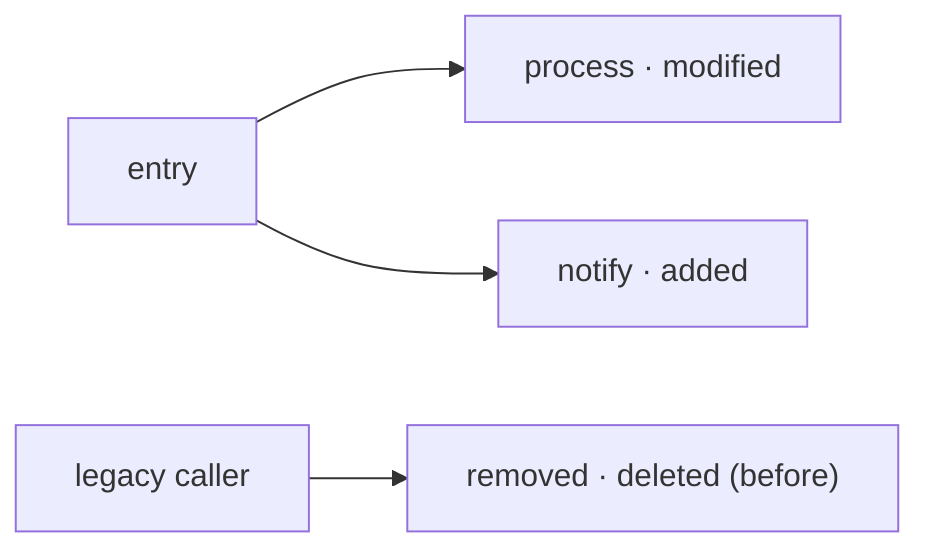
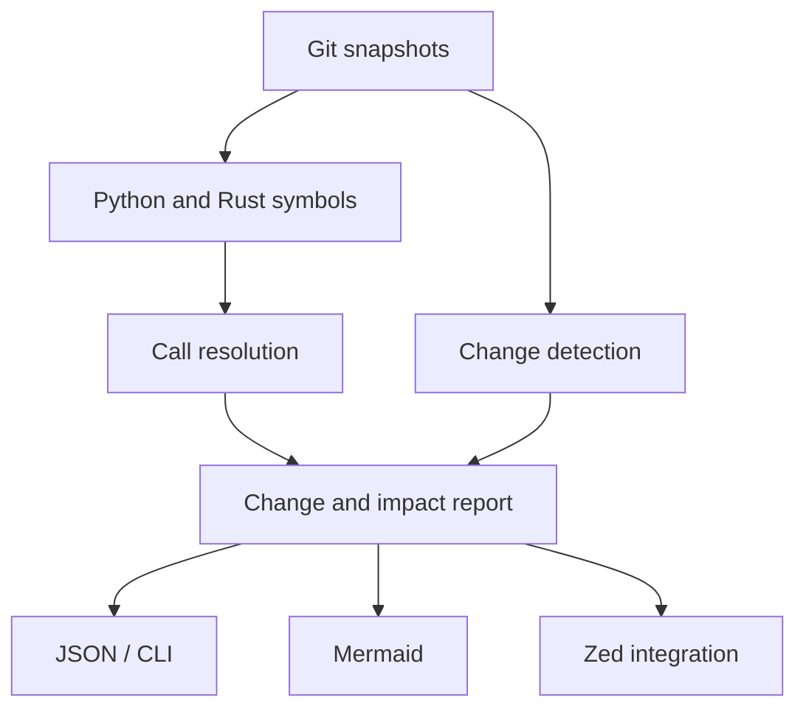

# DFlow

DFlow is an experimental Rust tool for exploring how changes in a Git repository affect Python and Rust function call graphs.

DFlow answers questions such as: *Which functions call the function I changed? What calls a newly added function? Who called a function before it was deleted?* It draws these relationships in the standalone CLI. A Zed integration is planned for later.

> **Status:** Python M4 technical validation is complete; its human comparative usability study remains open. Rust M5 adds captured-manifest/module discovery and conservative static analysis without building, running, or downloading dependencies of the analyzed project. DFlow compares Git snapshots, traces certain callers, draws an interactive terminal graph, exports Mermaid/Graphviz DOT source, and emits a [versioned JSON report](docs/report-schema-v2.md). Unresolved calls remain explicit.

## Intended workflow

1. Read two repository snapshots, such as a base commit and a target commit or working tree.
2. Parse captured Python and Rust source in both snapshots and identify functions, methods, imports, and call sites.
3. Match symbols across snapshots and classify them as added, modified, or deleted.
4. Resolve calls where possible and build a call graph for each snapshot.
5. Trace callers around changed symbols. Deleted symbols use the graph from the earlier snapshot.
6. Produce a structured report that presentation layers can render as JSON, Mermaid, or an editor view.

An intended diagram might look like this:



An arrow means **calls**: `entry → process` means `entry` calls `process`. To inspect the impact of a changed function, DFlow follows incoming arrows toward its callers.

## Architecture

The core will keep analysis separate from presentation:



The report carries symbol identity, source location, change type, call sites, and whether a call target was resolved. Dynamic Python calls and uncertain Rust dispatch remain explicitly unresolved rather than appearing as certain edges.

This is a conceptual boundary. The current implementation stays in one Rust crate with internal modules.

## Roadmap

- [x] Compare two Git snapshots and list changed Python and Rust files.
- [x] Extract Python functions and their source ranges.
- [x] Identify added, modified, and deleted symbols across snapshots.
- [x] Build a call graph for direct, statically resolvable calls.
- [x] Trace callers of changed symbols, including deleted symbols in the earlier snapshot.
- [x] Expose a stable JSON report through the CLI.
- [x] Draw an interactive terminal caller graph.
- [x] Analyze static Rust crate/module graphs and conservative intra-target calls.
- [x] Export focused Mermaid and Graphviz DOT diagrams from the shared caller graph.
- [ ] Prototype a Zed workflow using the same core analysis.

Python support focuses on local calls and explicit imports. A read of `obj.value` traces to a `@property` getter when `obj` has exactly one local assignment from a directly imported or local class constructor (`obj = Service()`). Calls on a parameter annotated with a unique local or directly imported class (`Rate` or `Optional[Rate]`, including quoted forward references) trace to an undecorated method of that class when the parameter is not rebound. These annotation-based edges assume the declared type; Python can pass subclasses or different objects at runtime. Untyped/reassigned receivers, property writes, other decorators, dynamic imports, and runtime-generated calls remain unresolved.

Supported Python resolution covers direct lexical calls, explicit repository imports, aliases, known relative imports, module-qualified calls, and the constrained member cases above. A nested directory containing `pyproject.toml` also serves as a module root, so imports within that project can resolve even when the Git repository root is its parent. Other assignments, wildcard imports, uncertain package attributes, decorators, and dynamic dispatch remain unresolved rather than creating guessed edges. Rust resolves lexical free/nested functions, explicit `crate`/`self`/`super` module paths, static `use` aliases, and unique inherent associated functions within one crate target. Receiver/trait/UFCS dispatch, macro expansion, glob imports, re-exports, conditional compilation, unknown procedural attributes, external crates, and ambiguous bindings stay unresolved. JSON `unresolved_reason` is an open string field; [schema v2](docs/report-schema-v2.md) documents its meanings. Neither language is executed.

## Development

Install Rust 1.95 or newer for the optional GUI dependencies (the headless and TUI crates also support older Rust 2024 toolchains), then run:

For source formatting, follow the [Rust code style guidelines](docs/code-style.md) and run `cargo fmt --all` before committing.

```sh
cargo run -- local
cargo run -- local --staged
cargo run -- local --unstaged
cargo run -- branch --base main --target feature
cargo run -- local --format json --depth 2 --include-test
cargo run -- local --format mermaid --depth 2 > impact.mmd
cargo run -- branch --base main --target feature --format dot > impact.dot
cargo run --features tui -- local --render tui
cargo run --features gui -- local --render gui
cargo run -- --dir ../other-repo local
cargo run -- branch --base main --target feature --dir ../other-repo
```

`--dir DIR` selects the starting directory for Git repository discovery in either mode. Relative paths resolve against the process current directory, not the repository root; paths inside a repository work because discovery ascends to its root. Without `--dir`, discovery starts at the process current directory. A missing or non-repository directory is invalid input (exit 2).
`--include-test` is off by default in both modes and can appear before or after the subcommand. Without it, conventional Python test files (`test_*.py`, `*_test.py`, `conftest.py`), Rust test files (`test_*.rs`, `*_test.rs`, `tests.rs`), and files under `test/`, `tests/`, or `__tests__/` are omitted. Test-named Python definitions (`test_*` and `Test*` classes) and Rust `#[test]`/`#[cfg(test)]` code within other source files are also omitted. With the flag, those files and definitions participate in both JSON reports and the TUI, including live reloads.
The default headless build emits JSON, including when both streams are terminals. With `--features tui`, interactive TUI is the default only when both stdin and stdout are terminals; otherwise JSON remains the default. `--render tui` (or legacy `--format tui`) requires both terminals and the `tui` feature; `--render gui` requires the `gui` feature and opens a native window even with redirected stdio. `--render` conflicts with `--format`; unavailable features exit 2 with rebuild guidance. `--format json` always writes one JSON object to stdout. `--format mermaid` and `--format dot` write one-shot plain diagram source without Markdown fences or terminal escapes. DOT is Graphviz source, not a rendered image; use `dot -Tsvg impact.dot -o impact.svg` if Graphviz is installed. Exit status is 0 for complete analysis, 1 for partial analysis or operational failure (including GUI startup), and 2 for invalid input. A parse error produces a partial report, while an unresolved call by itself does not.

Diagram nodes show qualified symbol name or module basename, repository-relative path, base/target provenance, and any added/modified/deleted status. Arrows point from caller to callee; `+ target` and `- base` mark changed call edges. `--depth` adds incoming callers to the focused comparison graph (depth 0 still includes changed-edge endpoints). An empty comparison emits `No symbol or edge changes`; incomplete analysis also emits `PARTIAL analysis`. Non-UTF-8 paths are shown as `hex:` followed by lowercase bytes. Diagram exports are one-shot and do not run a watcher or build the analyzed project.

Local TUI comparisons reload Git snapshots automatically when relevant source, ignore rules, index, or branch metadata changes; no keypress or restart is needed. Combined/unstaged mode observes worktree edits; `--staged` observes only committed/index changes. The TUI retains its last valid graph and displays `RELOAD ERROR` if a recapture fails, then clears the error after recovery. Invalid source is shown as partial analysis until repaired. Quitting with a remaining reload error exits 1. Branch comparisons stay fixed at their initially captured commit tips, and JSON output remains a one-shot report.
The GUI uses one captured comparison at launch (local changes do not live-reload). Drag nodes to reposition them, drag the background to pan, scroll to zoom, select nodes for base/target captured-source excerpts and call evidence, and use `+`/`−` to change caller depth. Changed roots and edge statuses have textual labels as well as color; deleted source comes from the base capture. Closing the window preserves the initial complete/partial exit status. The GUI never prints a report to stdout.

### Terminal controls

The terminal has two persistent areas: a DFlow information header showing both snapshot identities, caller depth, analysis completeness, and counts, above one full-width graph canvas. All changed symbols appear together, with unrelated caller graphs as separate islands and shared callers shown once. Each symbol box shows its function name as the title, prefixed by the class, struct, or trait name for methods (trait implementations use `<Type as Trait>.method`), and its worktree-relative path on the next line (module boxes use the module filename as the title), with one blank cell between each label and the box edges and dimmed paths. Boxes size to their content rather than truncating it. Press `d` to expand or collapse details inside the selected graph node, including snapshot-labeled source and call-site evidence where available; there is no separate Details panel. Expanded boxes can be wider than the viewport, so pan to see their full contents. Shared routes meet at junctions; panning clips the graph without breaking visible joins. Deleted roots and their callers use the **base** snapshot; added and modified roots use **target**. A partial analysis is visibly marked.

Connectors detour around intervening node boxes, so a direct call remains visible even when its source and target are separated by another node.

| Key | Action |
| --- | --- |
| Arrow keys or `j`/`k` | Select a graph node |
| `d` | Expand or collapse details in the selected graph node (collapsed by default) |
| Shift+arrow keys | Pan the graph, including wide nodes |
| Page Up / Page Down | Pan the graph vertically |
| `+` / `-` | Increase or decrease caller depth |
| `?` | Show or close help |
| `q` or Ctrl-C | Quit |

The graph renders in small terminals, including mobile SSH viewports; pan to inspect clipped nodes. A terminal smaller than 3 columns or 7 rows has no room for even one bordered graph cell and shows resize guidance. Renderer-owned box-drawing lines and arrows are single-cell Unicode glyphs. Added roots are green, deleted roots red, and modified roots yellow; roots with multiple change kinds have a distinct mixed style. Unchanged callers and connectors retain the terminal default color. The selected node's title is bold without changing its color.

Run the current test suite with:

```sh
cargo test
```

The root workspace contains `dflow-core` (headless snapshot/analysis/report/diagram library), `dflow-tui` (terminal library), `dflow-gui` (native graph library), and the `dflow` binary; `cargo run -- …` and `cargo test` default to the binary. `git2` captures Git snapshots. Tree-sitter parses Python and Rust source, including fixture-tested Rust 2018, 2021, and 2024 syntax editions (static syntax parsing, not edition-specific compiler/type checking). Python module discovery supports regular packages at the repository root or under `src/`, including a static setuptools `package-dir` root of `.` or `src` in `pyproject.toml`. Rust discovery uses captured root/workspace-member `Cargo.toml` manifests, conventional or explicit lib/bin roots, and unambiguous inline/external/`#[path]` modules; it does not expand Cargo globs, macros, build scripts, or dependencies. Missing/ambiguous Rust layouts and invalid source yield partial analysis. Local capture includes non-ignored untracked sources, skips symlinks and submodules, and rejects unresolved index conflicts. `petgraph` stores the call graphs; Ratatui and Crossterm draw the optional terminal view.

### Testing approach

Tests use small Python/Rust fixtures and temporary Git repositories to verify snapshot capture, symbol extraction, conservative call resolution, caller traversal, JSON references, source locations, package/module discovery, diagnostics, and terminal rendering. The [schema reference](docs/report-schema-v2.md) lists JSON fields and path encoding. [M4 validation](docs/m4-validation.md) records Python terminal, performance, and usability checks; [M5 validation](docs/m5-validation.md) records Rust checks and benchmarks.
