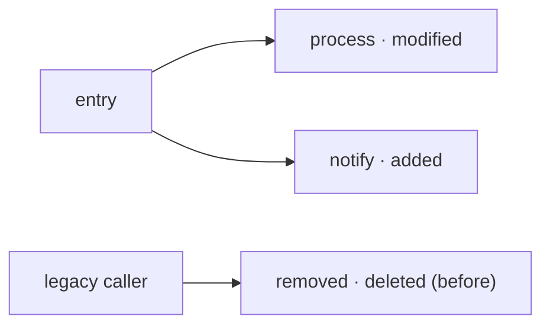
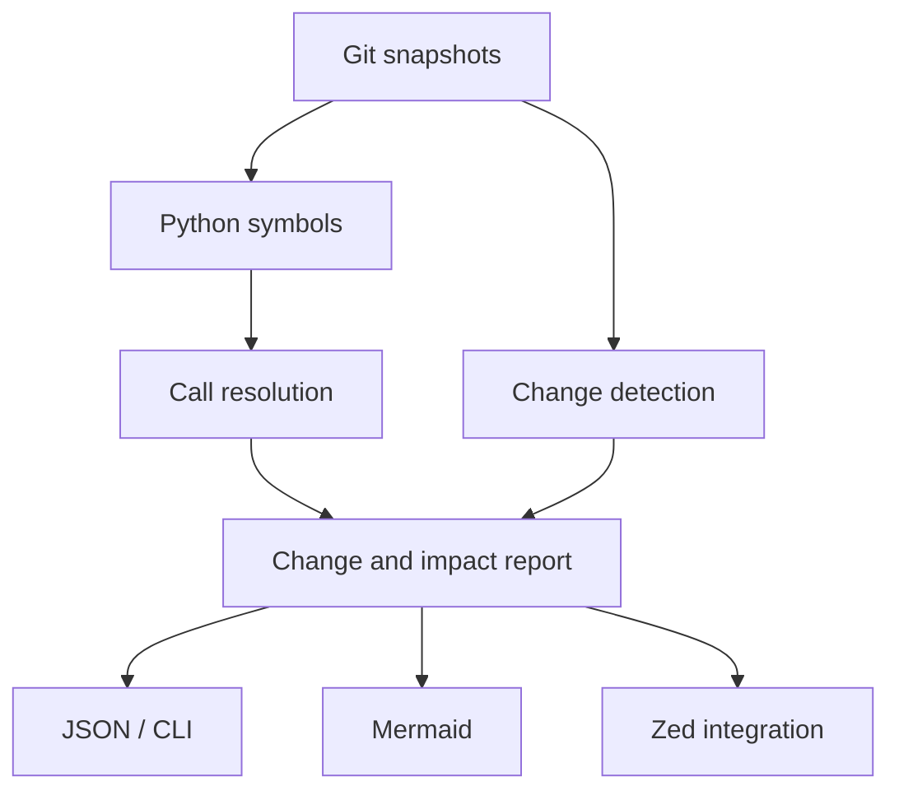

# DFlow

DFlow is an experimental Rust tool for exploring how changes in a Git repository affect a Python project's function call graph.

The goal is to answer questions such as: *Which functions call the function I changed? What calls a newly added function? Who called a function before it was deleted?* DFlow will turn those relationships into a diagram that can be used from a standalone CLI and, eventually, from Zed.

> **Status:** M3 JSON CLI. DFlow captures local or branch-tip Git snapshots, extracts Python symbols, resolves conservative static calls, traces callers, and emits a [versioned JSON report](docs/report-schema-v1.md). Interactive terminal graphs are planned for M4. Unresolved calls remain explicit; the tool does not run repository code.

## Intended workflow

1. Read two repository snapshots, such as a base commit and a target commit or working tree.
2. Parse Python files in both snapshots and identify functions, methods, imports, and call sites.
3. Match symbols across snapshots and classify them as added, modified, or deleted.
4. Resolve calls where possible and build a call graph for each snapshot.
5. Trace callers around changed symbols. Deleted symbols use the graph from the earlier snapshot.
6. Produce a structured report that presentation layers can render as JSON, Mermaid, or an editor view.

An intended diagram might look like this:



An arrow means **calls**: `entry → process` means `entry` calls `process`. To inspect the impact of a changed function, DFlow follows incoming arrows toward its callers.

## Architecture

The core will keep analysis separate from presentation:



The report should carry symbol identity, source location, change type, call sites, and whether a call target was resolved. Python allows dynamic calls, so an unresolved target must remain explicitly unresolved rather than appear as a certain edge.

This is a conceptual boundary, not the current crate layout. The first implementation can stay in one Rust crate; modules or crates can be split out as the interfaces become clear.

## Roadmap

- [x] Compare two Git snapshots and list changed Python files.
- [x] Extract Python functions and their source ranges.
- [x] Identify added, modified, and deleted symbols across snapshots.
- [x] Build a call graph for direct, statically resolvable calls.
- [x] Trace callers of changed symbols, including deleted symbols in the earlier snapshot.
- [x] Expose a stable JSON report through the CLI.
- [ ] Render focused Mermaid diagrams from the report.
- [ ] Prototype a Zed workflow using the same core analysis.

Initial Python support will focus on local calls and explicit imports. Method dispatch, dynamic imports, decorators, and runtime-generated calls require additional analysis and may remain unresolved.

## Development

Install a Rust toolchain that supports the 2024 edition, then run:

```sh
cargo run -- local
cargo run -- local --staged
cargo run -- local --unstaged
cargo run -- branch --base main --target feature
cargo run -- local --format json --depth 2
```

Run the current test suite with:

```sh
cargo test
```

The single root-level crate uses `git2` for Git snapshots. Tree-sitter parses Python source. Module discovery supports regular packages at the repository root or under `src/`, including a static setuptools `package-dir` root of `.` or `src` in `pyproject.toml`. Unsupported package layouts receive a diagnostic. `petgraph` stores the call graphs; Ratatui and Crossterm are declared for the planned terminal stage.

### Testing approach

Current tests use small Python fixtures and temporary Git repositories to verify snapshot capture, symbol extraction, conservative call resolution, caller traversal, JSON references, source locations, package discovery, and diagnostics. The terminal graph is the next milestone.
