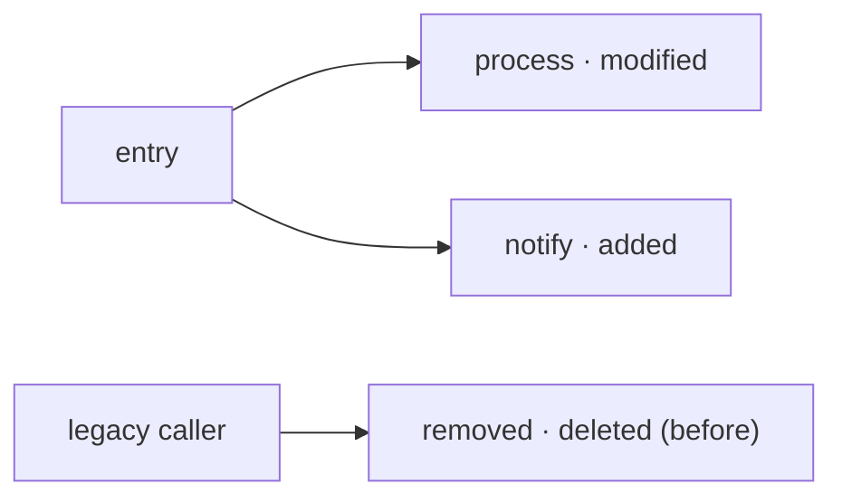
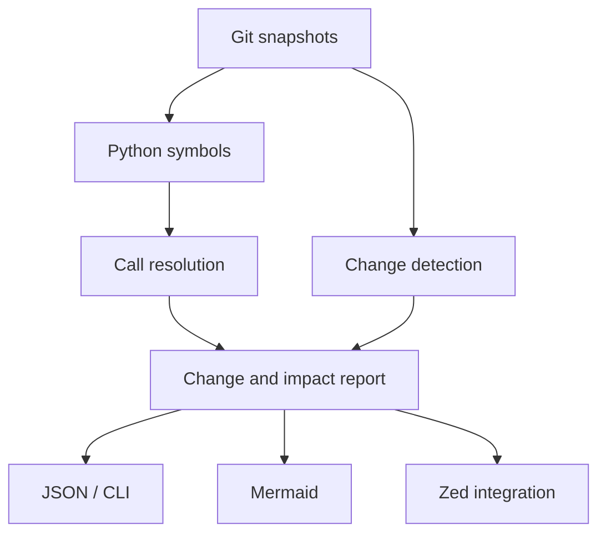

# DFlow

DFlow is an experimental Rust tool for exploring how changes in a Git repository affect a Python project's function call graph.

DFlow answers questions such as: *Which functions call the function I changed? What calls a newly added function? Who called a function before it was deleted?* It draws these relationships in the standalone CLI. A Zed integration is planned for later.

> **Status:** Python MVP. DFlow captures local or branch-tip Git snapshots, extracts Python symbols, resolves conservative static calls, traces callers, draws an interactive terminal graph, and emits a [versioned JSON report](docs/report-schema-v1.md). Unresolved calls remain explicit; the tool does not run repository code.

## Intended workflow

1. Read two repository snapshots, such as a base commit and a target commit or working tree.
2. Parse Python files in both snapshots and identify functions, methods, imports, and call sites.
3. Match symbols across snapshots and classify them as added, modified, or deleted.
4. Resolve calls where possible and build a call graph for each snapshot.
5. Trace callers around changed symbols. Deleted symbols use the graph from the earlier snapshot.
6. Produce a structured report that presentation layers can render as JSON, Mermaid, or an editor view.

An intended diagram might look like this:



An arrow means **calls**: `entry → process` means `entry` calls `process`. To inspect the impact of a changed function, DFlow follows incoming arrows toward its callers.

## Architecture

The core will keep analysis separate from presentation:



The report carries symbol identity, source location, change type, call sites, and whether a call target was resolved. Python allows dynamic calls, so an unresolved target remains explicitly unresolved rather than appearing as a certain edge.

This is a conceptual boundary. The current implementation stays in one Rust crate with internal modules.

## Roadmap

- [x] Compare two Git snapshots and list changed Python files.
- [x] Extract Python functions and their source ranges.
- [x] Identify added, modified, and deleted symbols across snapshots.
- [x] Build a call graph for direct, statically resolvable calls.
- [x] Trace callers of changed symbols, including deleted symbols in the earlier snapshot.
- [x] Expose a stable JSON report through the CLI.
- [x] Draw an interactive terminal caller graph.
- [ ] Render focused Mermaid diagrams from the report.
- [ ] Prototype a Zed workflow using the same core analysis.

Python support focuses on local calls and explicit imports. Method dispatch, dynamic imports, decorators, and runtime-generated calls require additional analysis and may remain unresolved.

Supported resolution covers direct lexical calls, explicit repository imports, aliases, known relative imports, and module-qualified calls where the binding is certain. Parameters, assignments, wildcard imports, uncertain package attributes, decorators, and dynamic dispatch remain unresolved rather than creating guessed edges. JSON `unresolved_reason` values include `dynamic_target`, `shadowed`, `ambiguous_binding`, `ambiguous_target`, `missing_target`, `external_target`, `wildcard_import`, `unknown_module`, `unsupported_dispatch`, `decorated_target`, and `parse_error`. The analyzer uses captured Python source and does not execute it.

## Development

Install a Rust toolchain that supports the 2024 edition, then run:

```sh
cargo run -- local
cargo run -- local --staged
cargo run -- local --unstaged
cargo run -- branch --base main --target feature
cargo run -- local --format json --depth 2
```

If both stdin and stdout are terminals, the default output is an interactive graph. Otherwise the default is JSON. `--format json` always writes one JSON object to stdout; `--format tui` requires both terminals. Exit status is 0 for complete analysis, 1 for partial analysis or operational failure, and 2 for invalid input. A parse error produces a partial report, while an unresolved call by itself does not.

### Terminal controls

The left panel selects changed functions, the middle panel shows caller → callee arrows, and the right panel shows captured source and call-site evidence. Deleted roots and their callers use the **base** snapshot; added and modified roots use **target**. Cycle boxes list their members in details. The header shows the comparison and snapshot identities. A partial analysis is visibly marked.

| Key | Action |
| --- | --- |
| Tab | Focus the next panel |
| Arrow keys or `j`/`k` | Select a change or graph node; scroll details |
| Shift+arrow keys | Pan the graph |
| Page Up / Page Down | Scroll the focused panel |
| `+` / `-` | Increase or decrease caller depth |
| `?` | Show or close help |
| `q` or Ctrl-C | Quit |

The terminal needs at least 100 columns and 16 rows for the three panels. Narrower terminals show resize guidance. Graph labels use plain ASCII for predictable cell width; full names and paths appear in details. Colors only highlight focus and selection.

Run the current test suite with:

```sh
cargo test
```

The single root-level crate uses `git2` for Git snapshots. Tree-sitter parses Python source. Module discovery supports regular packages at the repository root or under `src/`, including a static setuptools `package-dir` root of `.` or `src` in `pyproject.toml`. Unsupported package layouts receive a diagnostic. Local capture includes non-ignored untracked Python files, skips symlinks and submodules, and rejects unresolved index conflicts. `petgraph` stores the call graphs; Ratatui and Crossterm draw the terminal view.

### Testing approach

Current tests use small Python fixtures and temporary Git repositories to verify snapshot capture, symbol extraction, conservative call resolution, caller traversal, JSON references, source locations, package discovery, diagnostics, and terminal rendering. The [schema reference](docs/report-schema-v1.md) lists JSON fields and path encoding. [M4 validation](docs/m4-validation.md) records terminal, performance, and usability checks.
